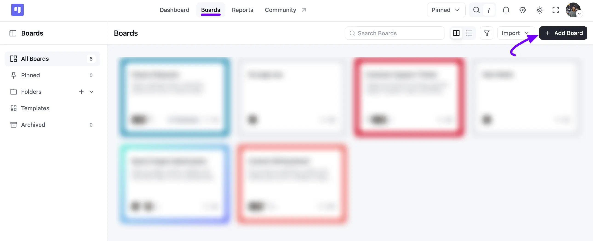
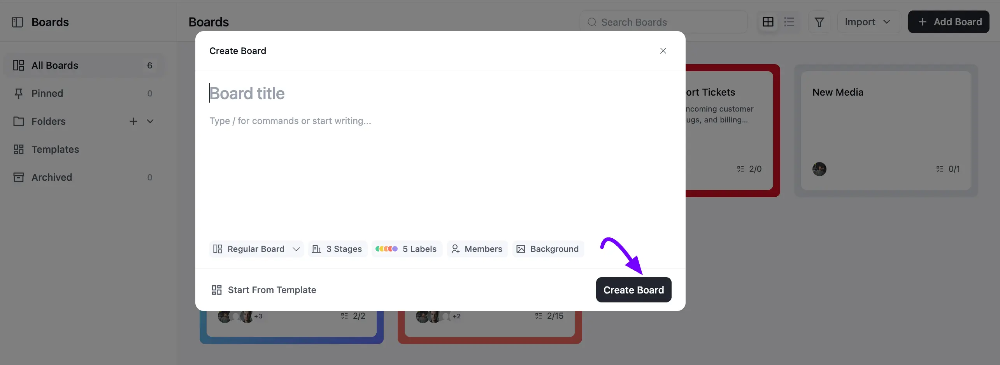
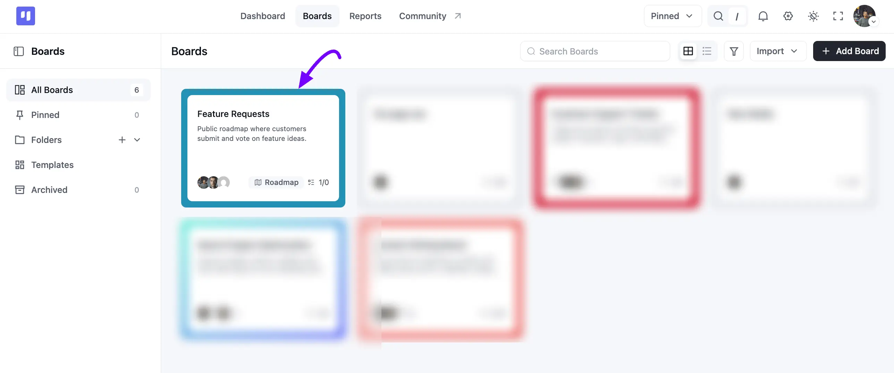
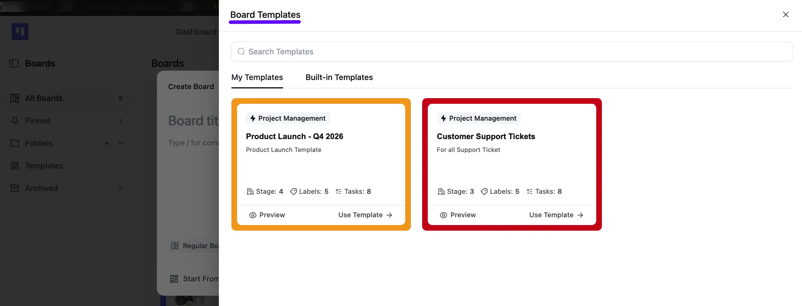
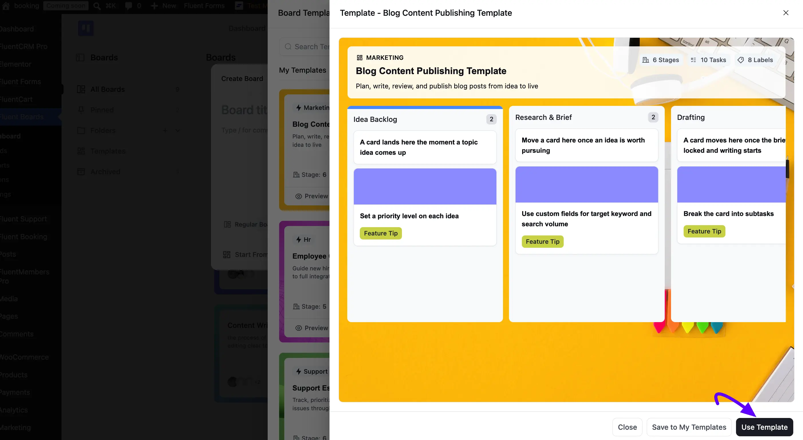
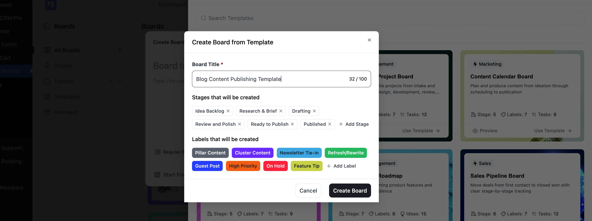
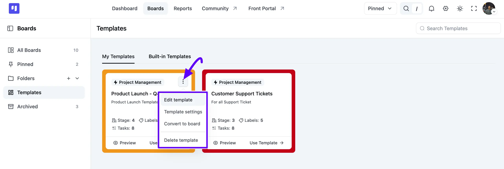

# Creating a New Board

Creating a new board in FluentBoards is quick and straightforward. You can set up your board with a title, description, stages, labels, members, and background, or start with a ready-made template. This guide walks you through the steps to create and set up a new board for managing your projects.

## Creating New Board

Go to your FluentBoards **Boards** section and click on the **+ Add Board** button in the top right corner.

A **Create Board** pop-up will appear. Enter a title in the **Board title** field, then add an optional description below it.

Use the row of options underneath to set up your board. Click **Regular Board** if you'd like to choose a different Board type, such as a **Roadmap Board**, instead. You can also set the number of **Stages**, add **Labels**, invite **Members**, or pick a **Background**. If you'd rather start with a ready-made structure, click **Start From Template**.

Once you're done, click the **Create Board** button.

And just like that, your board is ready to go! You can now begin adding stages and tasks to your newly created board.

## Creating a Board from a Template

Templates let you skip the setup and start with a board that already has stages, labels, and tasks. This feature needs FluentBoards Pro.

Click the **Start From Template** option at the bottom left of the **Create Board** pop-up. A **Board Templates** window will slide in from the right with two tabs.

You can also click **Templates** in the left sidebar of the **Boards** page. It opens the same two tabs on a full page.

- **My Templates:** Here you will find the templates you made yourself. If it's empty, open a board, go to **Board Menu**, and select **Make Template**.
- **Built-in Templates:** Here you will find ready-made templates from FluentBoards, grouped by category, such as **Marketing**, **HR**, and **Support**.

Type a name in the **Search Templates** field to find a template quickly. Each template card shows its category, title, and a short description. Down at the bottom, you will see how many **Stages**, **Labels**, and **Tasks** it includes.

> [!Note]
> If the **Built-in Templates** tab doesn't load, click the **Retry** button. FluentBoards fetches these templates online, so it needs a working internet connection.

### Preview a Template

Click the **Preview** button on any template card. A **Template** window will open. Here you will see the template's category, description, and totals for stages, tasks, and labels. Below that, each stage appears as a column with its sample tasks, so you know exactly what you'll get.

From the bottom of the preview window, you can:

- Click **Close** to go back to the list.
- Click **Save to My Templates** to keep your own copy of a built-in template. You can find it later in the **My Templates** tab.
- Click **Use Template** to start building your board.

### Use a Template

Click the **Use Template** button, either on the template card or in the preview window. A **Create Board from Template** window will appear so you can adjust the board before it's created.

1. Check the **Board Title** field. It starts with the template's name, so simply type over it to use your own. The title can be up to 100 characters.
2. Under **Stages that will be created**, review the list. Click the **x** next to a stage to remove it. To add your own, click **+ Add Stage** and enter a **Stage Name**. Your board needs at least one stage.
3. Under **Labels that will be created**, review the colored labels. Click **+ Add Label** if you'd like to include another one.
4. Once you're done, click the **Create Board** button. Click **Cancel** if you change your mind.

FluentBoards builds your board and adds the template's tasks. This may take a moment, so keep the window open until it finishes.

### Manage Your Own Templates

Go to **Templates** in the left sidebar and open the **My Templates** tab. Click the **three-dot** icon at the top right of any of your template cards to see these options:

- **Edit template:** Opens the template board so you can change its stages and tasks.
- **Template settings:** Lets you update the description and category.
- **Convert to board:** Turns the template back into a regular board in your boards list.
- **Delete template:** Permanently removes the template board and all of its tasks.

