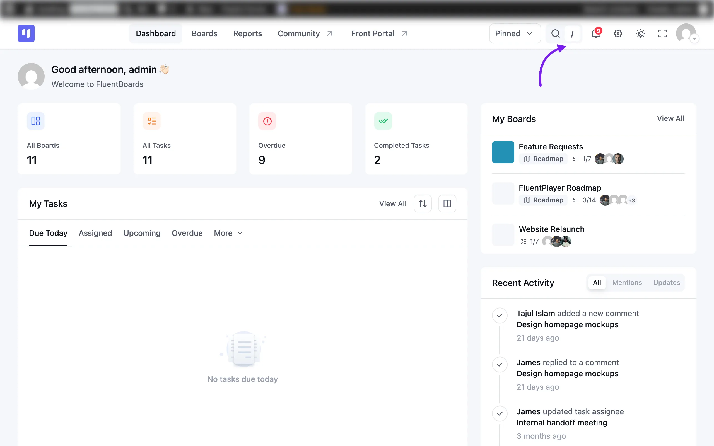
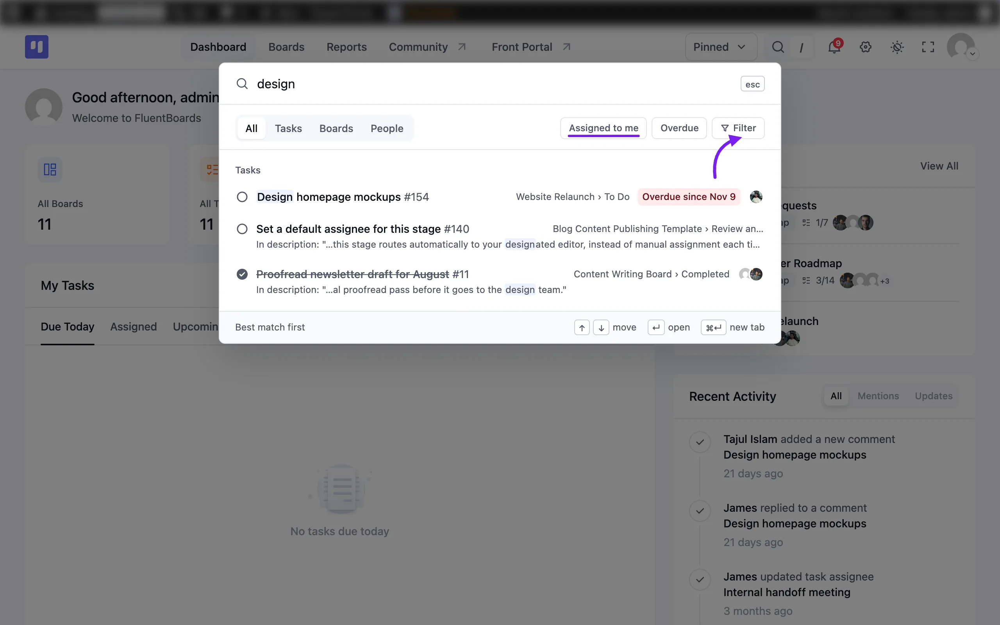
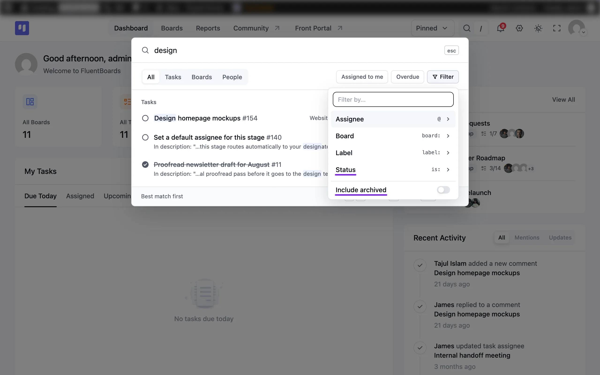

# Global Search

You can easily find any task, board, or teammate with Global Search. It looks across all your boards at once, so you never have to open each one.

## Open Global Search

Click the **Search** icon in the top navbar, or press **Cmd/Ctrl + K** on your keyboard. Then start typing.

> [!Note]
> **Cmd/Ctrl + K** works on screens where WordPress doesn't already use that shortcut. Cmd is for Mac, and Ctrl is for Windows.

Results are ranked, so the closest match appears first. Use the tabs above the results to narrow things down:

- **All**: Tasks, Boards, and People together.
- **Tasks**: Only tasks.
- **Boards**: Only boards.
- **People**: Only your teammates.

Subtasks show up in the results too. Click one and it opens inside its parent task.

## Narrow Your Search with Filters

Click the **Filter** button to open the filter pop-up. Here you can filter by **Assignee**, **Board**, **Label**, or **Status**.

Turn on the **Include archived** toggle to see archived tasks in your results.

For a faster start, simply click one of the quick chips under the search box:

- **Assigned to me**: Tasks assigned to you.
- **Overdue**: Tasks past their due date.

## Use Search Shortcuts

You can also type a shortcut straight into the search box. While the box is empty, it cycles through these shortcuts as hints.

| Type this | To find |
|---|---|
| `@name:` | Tasks assigned to a person |
| `board:` | Tasks on one board |
| `label:` | Tasks with a label |
| `is:` | Tasks by status, including archived tasks |

For example, type `board:` and pick a board to see only the tasks on it.

## Use Your Keyboard

Global Search is built for the keyboard. Here are the shortcuts you can use:

- **Cmd/Ctrl + K**: Open Global Search.
- **Cmd/Ctrl + Enter**: Open the selected result in a new browser tab.
- **Esc**: Step back, or close the search.
- **Backspace**: Remove the last filter you added.

Global Search also works in dark mode, right-to-left languages, and on your phone.
