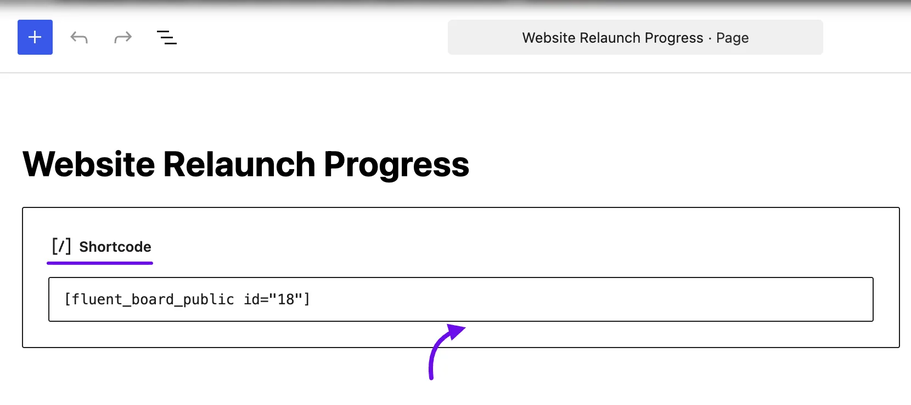
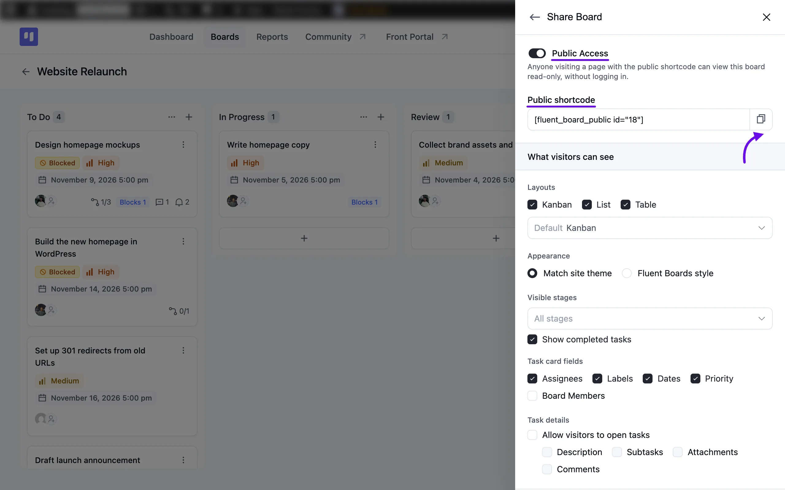
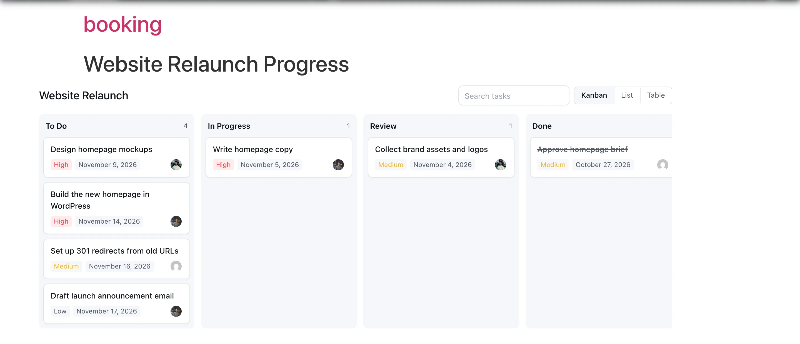
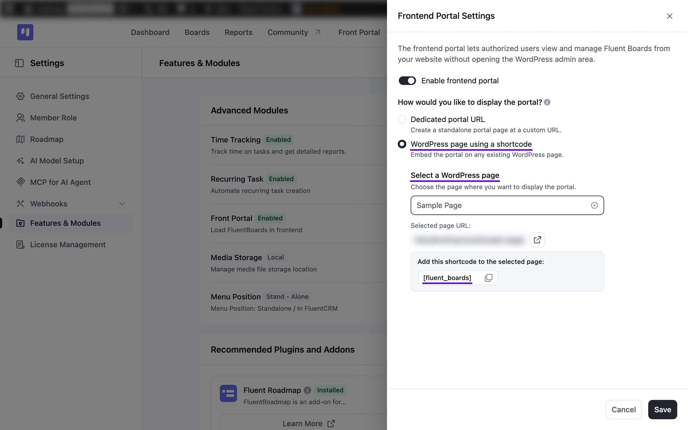
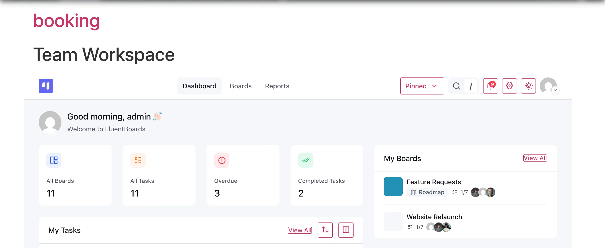
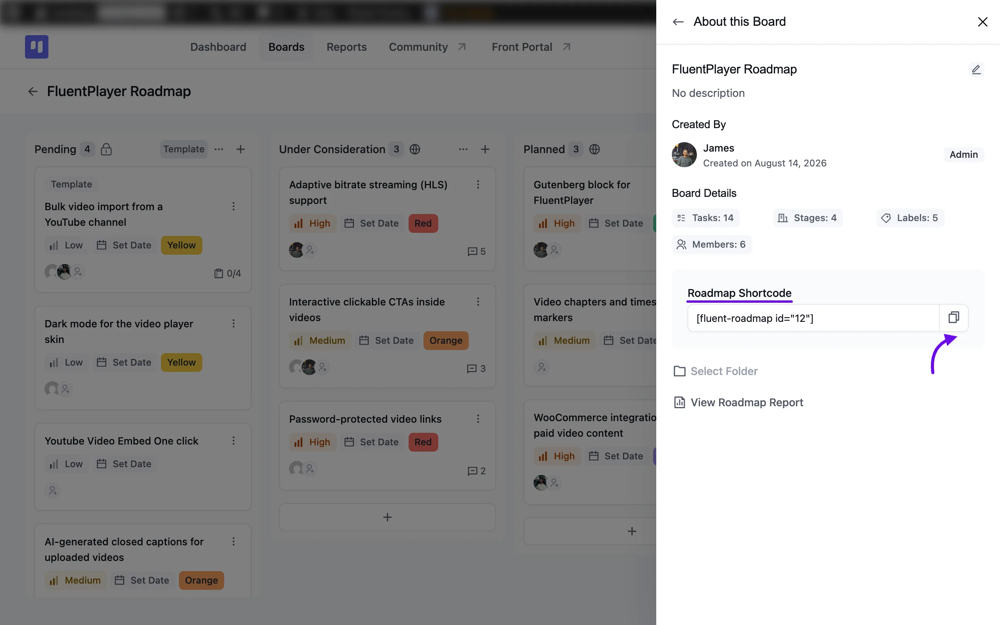
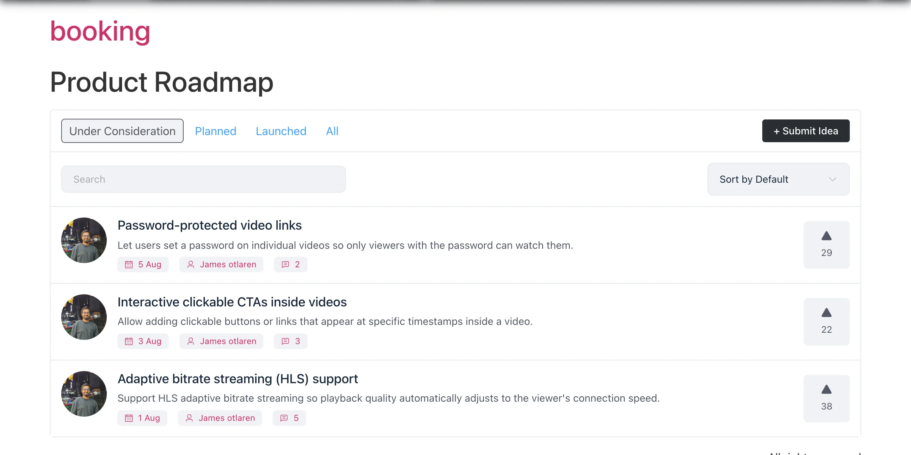

# FluentBoards Shortcodes

FluentBoards gives you a handful of shortcodes so you can embed your boards, your entire workspace, or your public Roadmap directly on any WordPress page. This is separate from the WordPress Dashboard view, letting you share your work with clients, teammates, or website visitors.

In this article, we'll walk you through every shortcode FluentBoards offers, what each one does, and where to find it.

## How to Use a Shortcode

Every shortcode in this article follows the same basic steps to add it to a page:

1. Go to **Pages** or **Posts** in your WordPress Dashboard and open the page you want to add it to, or create a new one.
2. Add a **Shortcode block** from the Gutenberg Blocks.
3. Paste your shortcode into the block.
4. Click the **Update** or **Publish** button to save your changes.



## Board Shortcode

The **Board Shortcode** embeds one board on any page and lets anyone view it without logging in. Visitors can only view it. They can't edit anything.

> [!Note]
> The **Board Shortcode** is available in FluentBoards Pro.

```
[fluent_board_public id="12"]
```

To get your shortcode, click the **Three Dot** button on your board and select **Share Board**. Turn on the **Public Access** toggle, then click the **Copy** icon next to **Public shortcode**. Only board managers and admins can change these settings.



The shortcode won't display anything if **Public Access** is off or the board is archived.

From the same **Share Board** panel, you can choose which layouts visitors get (Kanban, List, or Table), match your site theme or use the Fluent Boards style, and decide whether visitors can open tasks, see attachments, and more. Learn more in the [Share Board](/board-settings#share-board) section.

Here you will see how the public board looks on your page.



The board displays at wide width by default. To use the full page width, add `align="full"` to the shortcode, if your theme supports it. If the board looks cut off or off-center, add `align="none"` to keep it inside your page's content area.

## Frontend Portal Shortcode

The **Frontend Portal Shortcode** embeds your entire FluentBoards workspace, all boards, tasks, and the dashboard, on a single page. This gives your board members a way to log in and work from your website's frontend instead of the WordPress Dashboard.

```
[fluent_boards]
```

> [!Note]
> The **Frontend Portal Shortcode** is available in FluentBoards Pro.

This shortcode doesn't need an **id** attribute, since it loads your whole workspace based on the visitor's permissions.

Before using it, go to **Settings > Features & Modules**, turn on the **Front Portal** toggle, click its **Manage** button, and choose **WordPress page using a shortcode** under **How would you like to display the portal?**. 

Choose your page from the **Select a WordPress page** dropdown, then click the **Save** button. The dropdown only lists published pages. For more details, check out the [Frontend Portal](/frontend-portal-settings) guide.



The shortcode only works with this option selected. With **Dedicated portal URL** selected, your page shows the shortcode as plain text.

Once it's set up, your board members will see the portal on your page. Visitors who aren't logged in will see a login form instead.



## Roadmap Shortcode

The **Roadmap Shortcode** embeds your public-facing Roadmap board, where visitors can browse ideas, vote, and submit their own suggestions.

> [!Note]
> This shortcode needs the **Fluent Roadmap** addon. Learn how to install it in the [Roadmap Overview](/fluentboards-roadmap-overview) guide.

```
[fluent-roadmap id="12"]
```

Replace `12` with your Roadmap Board's ID. To find it, go to your Roadmap Board, click the **Three Dot** menu, then select **About this Board**. You'll find the **Roadmap Shortcode** field there, already filled in.



Visitors can browse your Roadmap without logging in. Depending on your **Roadmap Settings**, they may need to log in to submit ideas, vote, or add comments. Check out the [Roadmap Settings](/roadmap-settings) guide to configure this.



