# MCP for AI Agents

With FluentBoards, you can connect your boards to AI tools like **Claude Code**, **Claude Desktop**, **Codex**, **Cursor**, and **VS Code** using MCP (Model Context Protocol). Once connected, you can ask your AI assistant to read your boards, create tasks, move tasks, assign members, and add comments, all in plain language.

Every connection uses a **connection key** that you create inside FluentBoards. Your AI assistant only ever has the same permissions as your own account. It never gets more access than you already have.

> [!Note]
> The AI tools available through MCP are different from the built-in AI features inside task cards. If you want AI to write task descriptions or summarize a card, check out the [AI Features in Task Cards](/ai-features-in-task-cards) guide instead.

## Open the MCP Settings

Go to your **FluentBoards Dashboard** and click on **Settings** from the top menu or left sidebar. Select the **MCP for AI Agent** tab from the settings menu.

Here you will find everything you need to enable MCP, install the required plugin, check your connection status, and connect your preferred AI client.

## Step 1: Enable MCP for AI Agents

Simply toggle on the **Enable MCP for AI Agents** switch at the top of the page. Once enabled, FluentBoards makes its tools available to authorized AI clients.

> [!Note]
> If you ever want to stop every connected AI tool from accessing FluentBoards, just turn this toggle off. Your other MCP settings stay unchanged.

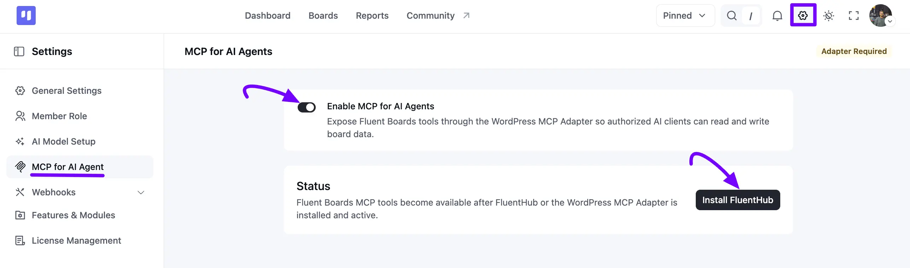

### Let Board Members Use MCP

By default, only administrators can connect AI tools. Toggle on **Allow board members to use MCP** if you want every board member to create their own connection key. Their AI assistant can only use the boards they can already access. Turn it off to block member connections again.

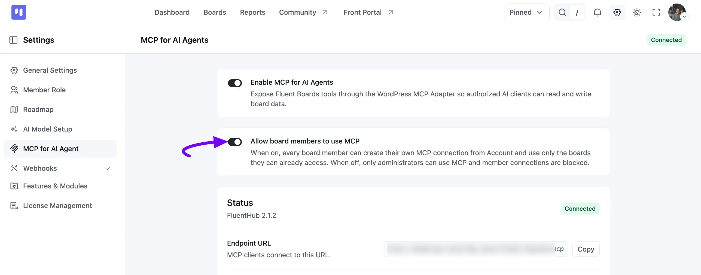

## Step 2: Install and Activate FluentHub

FluentBoards uses a lightweight companion plugin called **FluentHub** to power this connection. If it's missing or inactive, you'll see an **Adapter Required** notice on the settings page.

* **One-Click Installation:** Click the **Install FluentHub** button on the settings page. WordPress downloads, installs, and activates it for you.
* **Manual Installation:** Download the **FluentHub** plugin archive, then go to **Plugins → Add New → Upload Plugin**. Upload the file, click **Activate**, and return to the **MCP for AI Agent** tab.

> [!Note]
> Prefer to install it yourself? Download FluentHub directly from [static.wpmanageninja.com/fluent-toolkit.zip](https://static.wpmanageninja.com/fluent-toolkit.zip), then upload the ZIP via **Plugins → Add New → Upload Plugin** and activate it. Come back to this page afterwards and the endpoint fields appear.

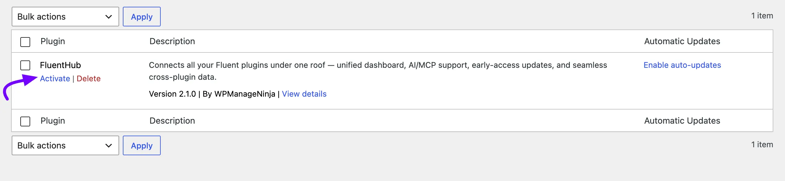

## Step 3: Check the Connection Status

Once the toggle is on and FluentHub is active, review the **Status** panel. It confirms your site is ready to accept AI connections.

| Field | Description |
| --- | --- |
| **Adapter** | Shows your active FluentHub version with a green **Connected** badge. |
| **Endpoint URL** | The address your AI client needs to reach FluentBoards. Click **Copy** to grab it. |
| **Tools Available** | The total number of MCP tools your AI client can use. |

> [!Note]
> If **Tools Available** shows 0, double-check that the **Enable MCP for AI Agents** toggle from Step 1 is switched on.

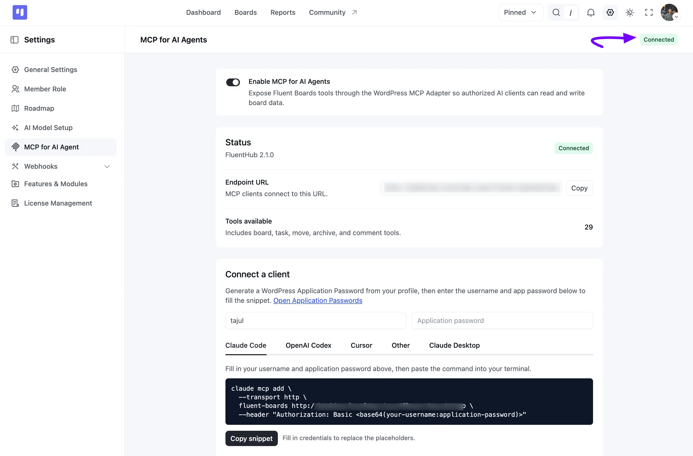

## Step 4: Create a Connection Key

AI clients sign in to FluentBoards with a **connection key**, not your regular login password. You create it right inside FluentBoards, so you never need to visit the WordPress admin area. You can also revoke a single key later without changing your main password.

### Open Your MCP Connections

Click the **Open my MCP connections** button in the **Connect a client** section of the **MCP for AI Agent** tab. You can also click your **Profile** image and open the **Account** tab.

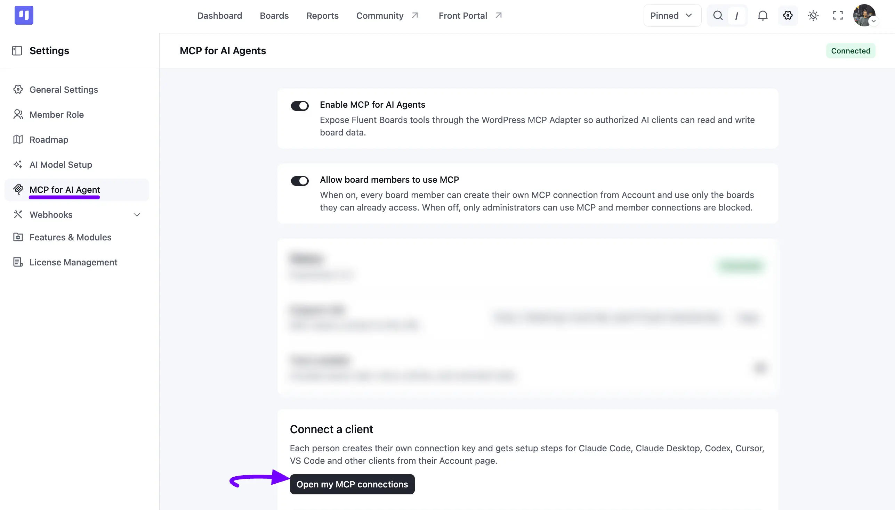

### Create the Key

Here you will find the **MCP Connections** card with the **Create a connection key** section.

1. Enter a name in the **Name** field, such as *Claude Code on my laptop*. Use one key per device or app.
2. Click the **Create key** button.
3. Click **Copy** next to the **Password**, and note your **Username** too.
4. Click **I have saved it** once you've stored the password safely.

> [!Warning]
> The password is shown only once. If you lose it, revoke that key and create a new one.

Don't worry about pasting these details into your AI client by hand. The setup code in the next step already includes your new key.

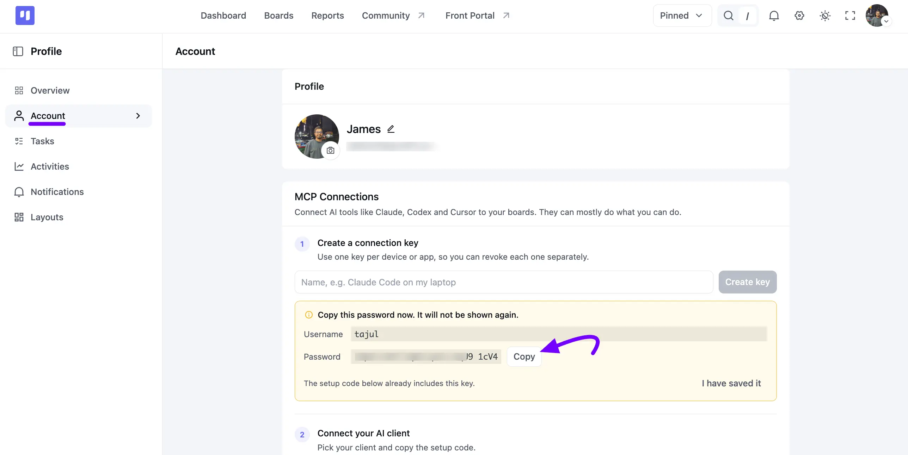

### Or Use a WordPress Application Password

Prefer the classic way? A WordPress **Application Password** works too. Your AI client signs in with it instead of a connection key.

1. Go to **Users → Profile** from your WordPress dashboard and scroll down to the **Application Passwords** section.
2. Enter a name that identifies the connection, such as *Claude Desktop* or *Cursor*.
3. Click **Add New Application Password**.
4. Copy the generated password and save it somewhere safe.

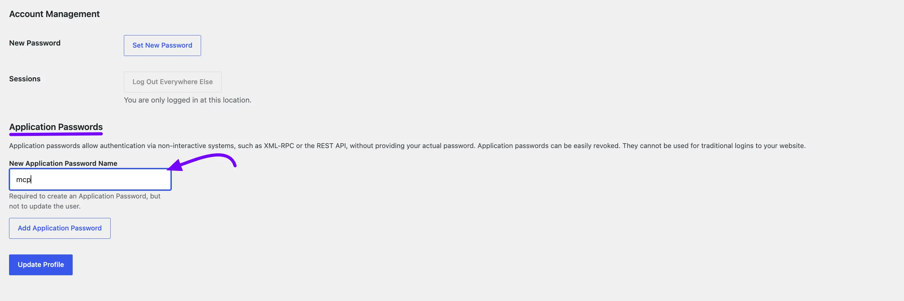

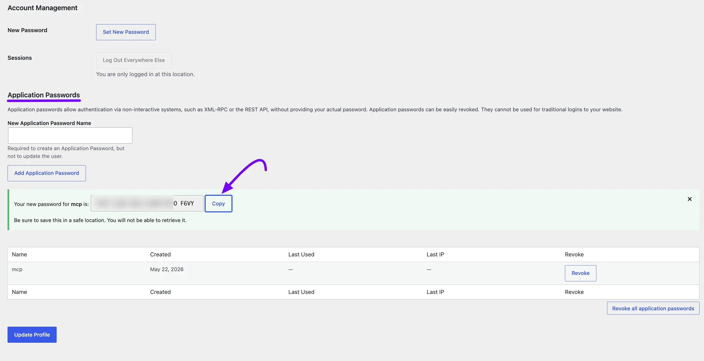

> [!Warning]
> This password is shown only once. If you leave the page before copying it, revoke that entry and generate a new one.

Use your WordPress username and this password in your AI client's setup code.

## Before You Connect: Check for Node.js

Some AI clients, including Claude Desktop and Cursor, need a small helper tool called **Node.js** to talk to your site. Most AI clients guide you through this automatically, but it helps to check first.

Open **Terminal** (on Mac) or **Command Prompt** (on Windows) and run:

```bash
node -v
```

If a version number appears, you're all set. If the command isn't recognized, head to [nodejs.org](https://nodejs.org), download the **LTS** version, and run the installer. Restart your computer once it finishes, then fully quit and reopen your AI client before connecting.

> [!Note]
> This is a one-time setup. Once Node.js is installed, you won't need to check for it again for future MCP connections.

## Step 5: Connect Your Preferred AI Client

On the **Account** tab, scroll down to the **Connect your AI client** section. Here you will find the **Server URL** and a setup code for each client. If you just created a key, the code is already filled in for you. Until then, it shows placeholders.

1. Choose the tab for your AI client: **Claude Code**, **Claude Desktop**, **Codex**, **Cursor**, **VS Code**, or **Other**.
2. Follow the short steps shown under the tab.
3. Click **Copy** next to the setup code to copy it to your clipboard.

Here's the full flow for each client as a worked example. The same idea applies to every tab. Only the setup code and where you paste it change.

### Connecting Claude Code

1. **Copy the setup code.** Select the **Claude Code** tab and click **Copy** next to the code. It looks like this:

```bash
claude mcp add --transport http fluent-boards \
  https://your-site.com/wp-json/fluent-boards/mcp \
  --header "Authorization: Basic <encoded-credentials>"
```

2. **Run it in your terminal.** Paste the code into your terminal and press **Enter**. This adds FluentBoards to Claude Code.

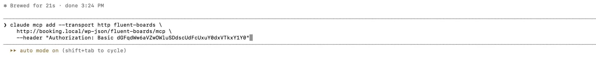

3. **Check the connection.** Start Claude Code and type `/mcp`. Here you will see `fluent-boards` listed with a green check mark and the number of tools available.

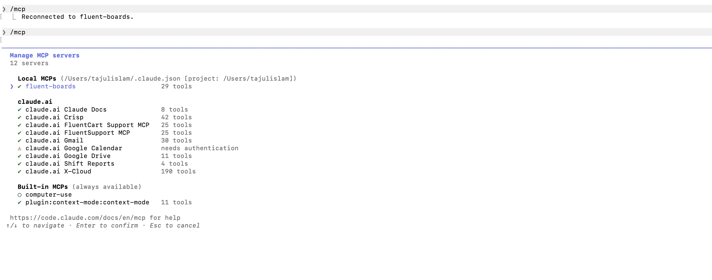

4. **Try an example.** Ask Claude Code to do something simple, like `create a board name -'test fluentboard'`. Claude Code calls FluentBoards and replies with the board it created, including its stages, labels, and members.

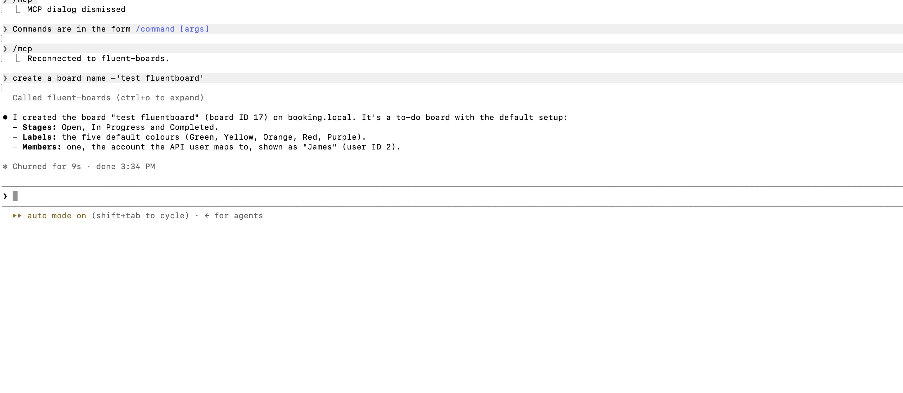

5. **See it in FluentBoards.** Open the **Boards** section of your FluentBoards Dashboard. Your new board is already there with the default stages.

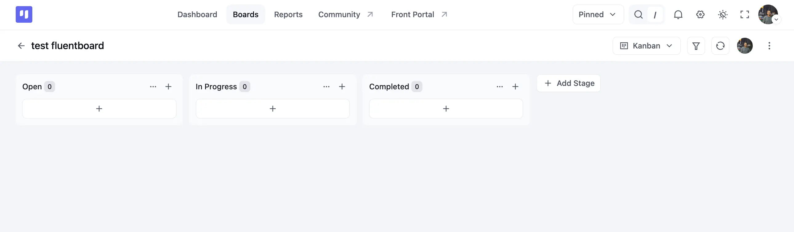

You can also verify the connection anytime by running `claude mcp list` or `claude mcp get fluent-boards`.

### Connecting Claude Desktop

Claude Desktop reads its MCP servers from a configuration file, and it opens that file for you.

1. Go to **Settings → Developer → Edit Config**. Claude Desktop creates the file if it doesn't exist yet and shows you where it lives. On macOS, it's `~/Library/Application Support/Claude/claude_desktop_config.json`. On Windows, it's `%APPDATA%\Claude\claude_desktop_config.json`.
2. Open the file in a plain text editor. TextEdit on macOS or Notepad on Windows both work fine.
3. Select the **Claude Desktop** tab in FluentBoards, click **Copy**, and paste the code into the file. Keep the surrounding JSON valid if you already have other servers listed.
4. Save the file and fully quit Claude Desktop, then open it again. Closing the window isn't enough. Quit it from the menu bar (macOS) or the system tray (Windows).

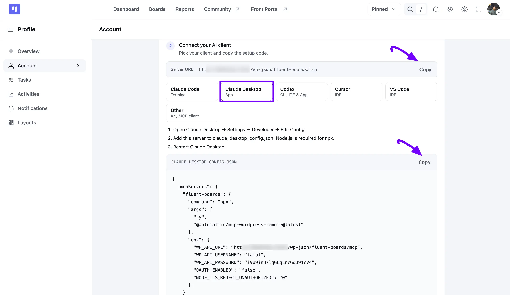

> [!Note]
> Claude Desktop needs Node.js for this connection. See the Node.js check above. Feel free to paste the code into a Claude Desktop or Claude Code chat and ask it to update the file for you instead.

### Connecting Codex

Select the **Codex** tab. It gives you two setup codes, one for the Codex CLI and IDE extension, and one for the Codex app.

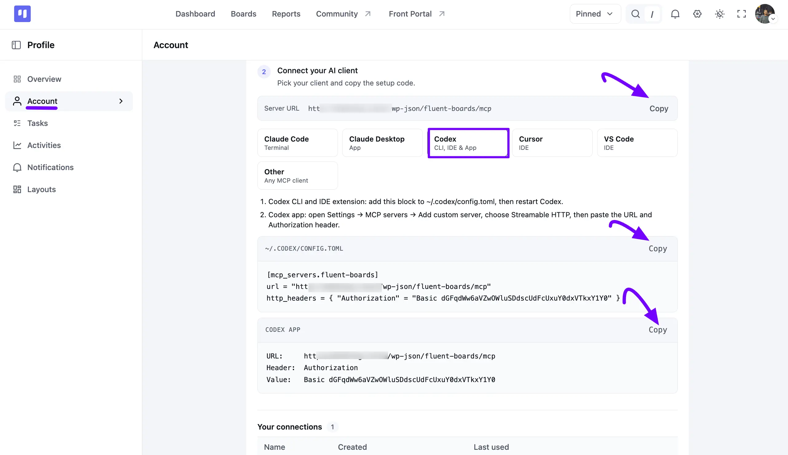

**Codex CLI and IDE extension:** Click **Copy** next to the `~/.codex/config.toml` code. Add it to that file, then restart Codex.

**Codex app:** Click **Copy** next to the **Codex App** code. Then open the Codex app and go to **Settings → Plugins**. Add a custom MCP server and fill in the details from the code:

* **Name:** fluent-boards
* **Type:** Streamable HTTP
* **URL:** your Server URL
* **Headers:** Authorization, with the `Basic …` value from the code

Click **Save**, and everything is ready to run.

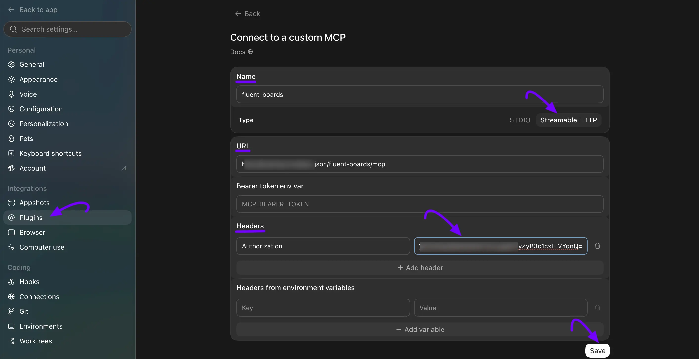

### Connecting Cursor

1. **Open Cursor's MCP settings.** In **Cursor**, open the command palette and search for **Cursor Settings**, then go to **Tools & MCPs** in the left sidebar. Under **Installed MCP Servers**, click **New MCP Server**.

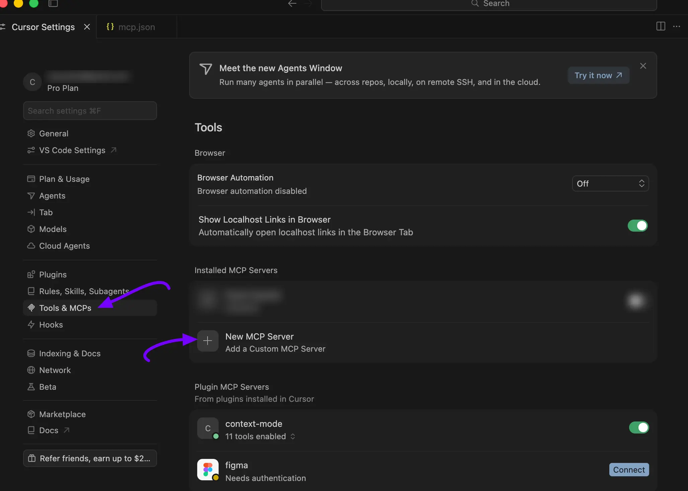

2. **Copy the setup code.** In FluentBoards, select the **Cursor** tab and click **Copy** next to the `~/.cursor/mcp.json` code. It looks like this:

```json
{
  "mcpServers": {
    "fluent-boards": {
      "type": "http",
      "url": "https://your-site.com/wp-json/fluent-boards/mcp",
      "headers": {
        "Authorization": "Basic <encoded-credentials>"
      }
    }
  }
}
```

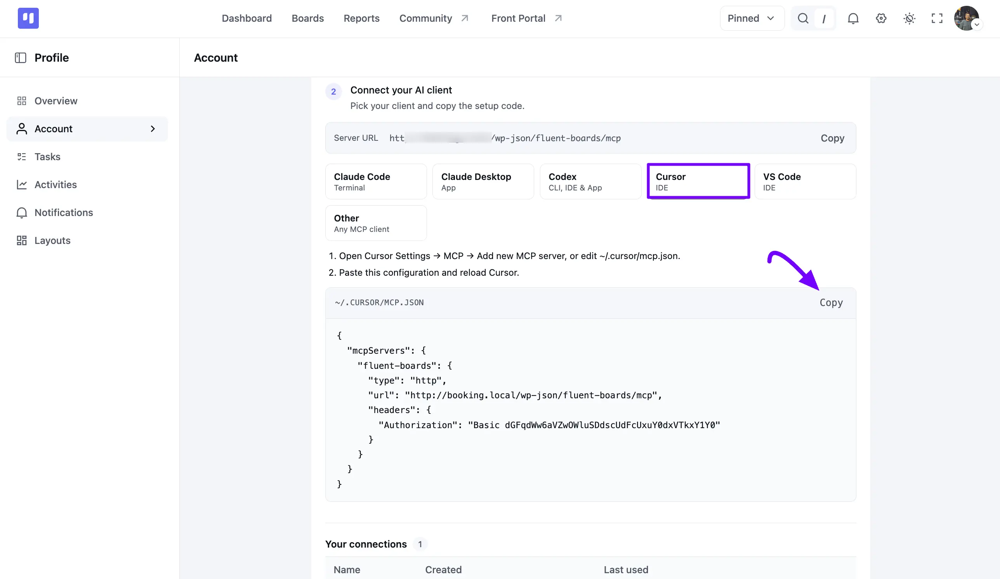

3. **Paste it into mcp.json.** Cursor opens an editor for the **mcp.json** file. Paste the code in and save.

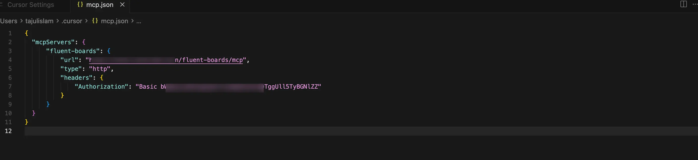

4. **Save and reload.** Reload **Cursor** and open **Tools & MCPs** again. You'll see `fluent-boards` in your **Installed MCP Servers** list with its available tools underneath.

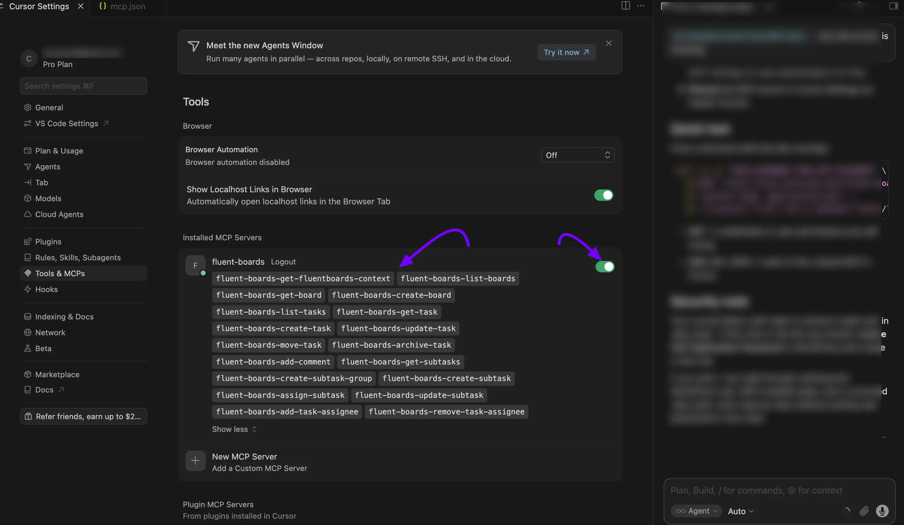

### Connecting VS Code

1. Select the **VS Code** tab in FluentBoards and click **Copy** next to the `mcp.json` code.
2. In VS Code, open the Command Palette and run **MCP: Open User Configuration**. You can also create a `.vscode/mcp.json` file in your project.
3. Paste the code into the file and save it.
4. Start the server from the MCP view in VS Code.

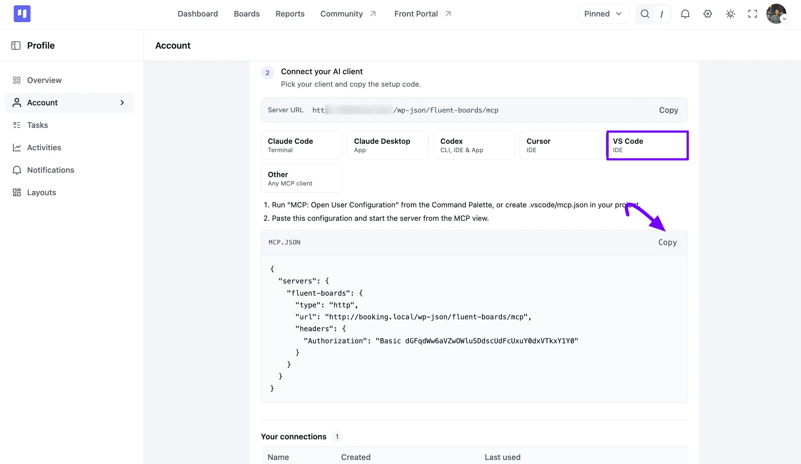

### Connecting Other MCP Clients

If you use another AI application that supports MCP, select the **Other** tab. Use the **Streamable HTTP** transport with the URL and **Authorization** header shown in the **Connection** box.

Want to test the connection first? Click **Copy** next to the **Quick Test** box and run that `curl` command in your terminal. If it works, you'll get back a list of FluentBoards tools.

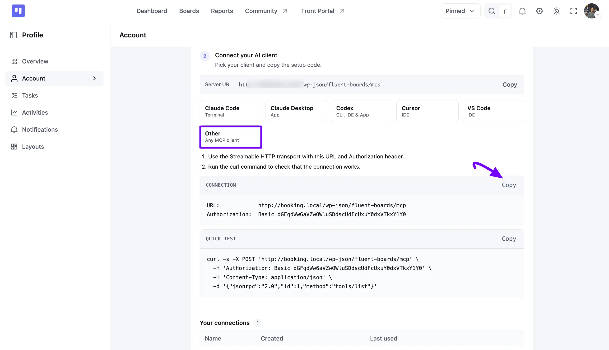

### Connecting ChatGPT

ChatGPT can work with custom MCP apps, but this depends on your ChatGPT plan and workspace settings. OpenAI currently documents full MCP support, including write actions, for supported Business, Enterprise, and Edu workspaces.

If your ChatGPT workspace supports custom MCP apps:

1. Make sure your workspace has access to **Developer mode** or custom MCP apps.
2. In ChatGPT, open **Settings** and go to the **Apps** or developer section.
3. Create a new custom MCP app.
4. Enter the **Server URL** from the **Connect your AI client** section.
5. Configure the authentication method your workspace requires.
6. Load the available FluentBoards tools.
7. Save the app and enable it for your account or workspace.
8. Open a new ChatGPT conversation, select the FluentBoards app, and test it with a simple request.

> [!Note]
> This is different from the **Codex** connection above. Codex uses the setup code FluentBoards generates for you directly, while ChatGPT connects through your workspace's own custom MCP app settings. Availability and steps can change as OpenAI updates this feature, so follow the current instructions inside your ChatGPT workspace.

## Step 6: Verify It's Working

Open your AI client and ask it to do something real, like creating a board or listing your tasks.

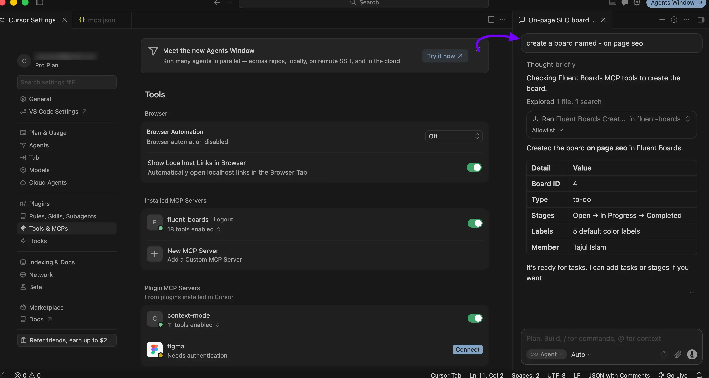

Now check the front end of your site. Go to your **Boards** section, and you'll see the AI's changes reflected there too.

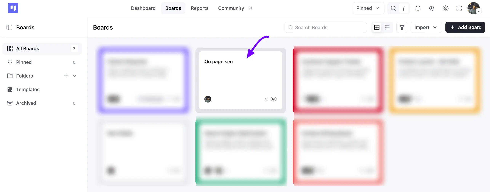

## What Your AI Agent Can Do

Once connected, you don't need to remember any technical commands. Just describe what you want, and your AI agent picks the right action.

### Boards and Workspace

* **List your boards** and see what's available across your account.
* **Get an overview** of a board, including its stages, labels, and members.
* **Create a new board**, complete with custom stages and labels.

**Try asking:** *"List all my FluentBoards."* or *"Create a board called 'Retainer Radar' with stages New Request, In Progress, Client Review, Delivered."*

### Tasks and Stages

* **Create, update, and move tasks** between stages.
* **Search or filter tasks** by status, priority, or due date.
* **Organize checklists** with subtasks and subtask groups.

**Try asking:** *"Create a task called 'Draft marketing budget' in the Planning board under the To-Do stage."* or *"Move the Homepage Design task to In Progress."*

### Team and Collaboration

* **Assign or remove members** on a task.
* **Add labels** to keep tasks organized.
* **Add comments** to keep collaboration inside the task.

**Try asking:** *"Assign the website redesign task to John."* or *"Add a comment to the Design Fixes task saying the assets have been reviewed."*

### A Few More Prompt Ideas

* *"What tasks are overdue across all my boards?"*
* *"Summarize progress on the Smith & Co. Redesign board: what's done, in progress, and blocked."*
* *"Archive everything marked Done on the E-Commerce Redesign board."*
* *"Give me an overview of the tasks currently in progress across my boards."*

## Security, Revocation, and Best Practices

* **Isolated Access:** Create a separate connection key for each device or AI client you connect. If you stop using one client, you can remove it without breaking the others.
* **Revoking Access:** To disconnect a client right away, open the **MCP Connections** card on your **Account** tab, find the key under **Your connections**, and click **Revoke**. AI clients using that key stop working right away.
* **Credential Safety:** The generated snippet contains an encoded access token. Treat it like a password. Never paste it into public repositories, pastebins, or shared screenshots.
* **Reviewable by Design:** Most AI clients ask you to approve a new action the first time it runs, unless you've set it to always allow. Nothing happens silently in the background.
* **Team Use:** Each teammate can create their own connection key from their **Account** tab, so their AI assistant only ever sees what that person can already access.

## Troubleshooting Common Issues

* **The "Adapter Required" Notice Won't Go Away:** Refresh the settings page. If it's still there, go to your **Plugins** page and confirm **FluentHub** is listed as **Active**.
* **The AI Client Reports an "Unauthorized" Error:** Your key may have been revoked, or the setup code may have a typo. Create a fresh connection key and copy a new setup code.
* **The Connection Looks Active, but Nothing Happens:** Check that you replaced any placeholder text in your AI client's configuration with your real connection key. A "connected" status only confirms the tool started, not that it logged in successfully.
* **It Works Locally but Not on Your Live Site:** Confirm your **Endpoint URL** uses the correct domain and protocol (HTTP vs HTTPS), and that your site's REST API is publicly reachable.
* **You Can't Create a Connection Key:** The **MCP Connections** card shows the reason. MCP may be turned off, FluentHub may be inactive, or you may not have permission. Ask an administrator to check **Settings → MCP for AI Agent**.
