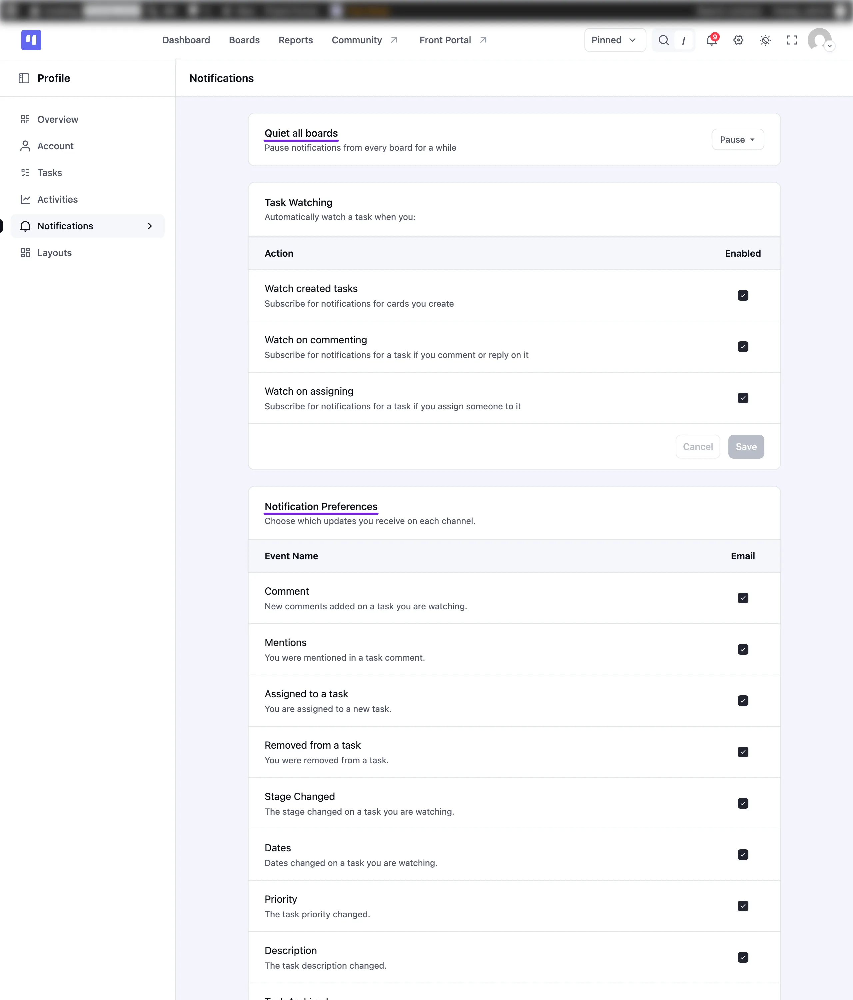
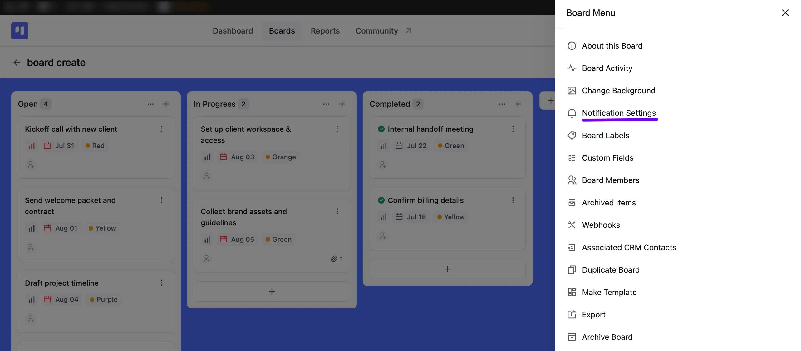
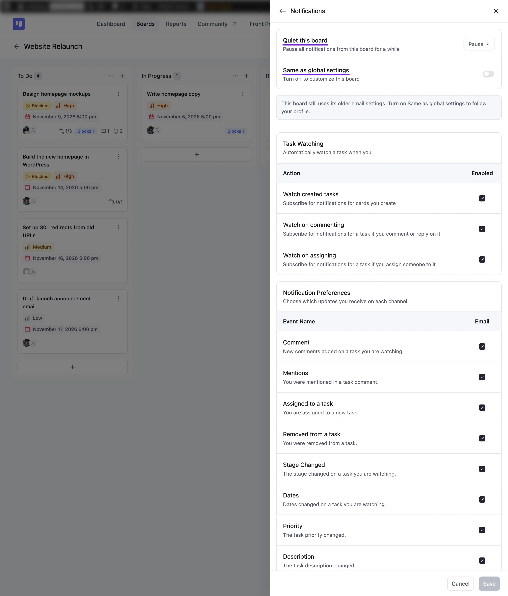
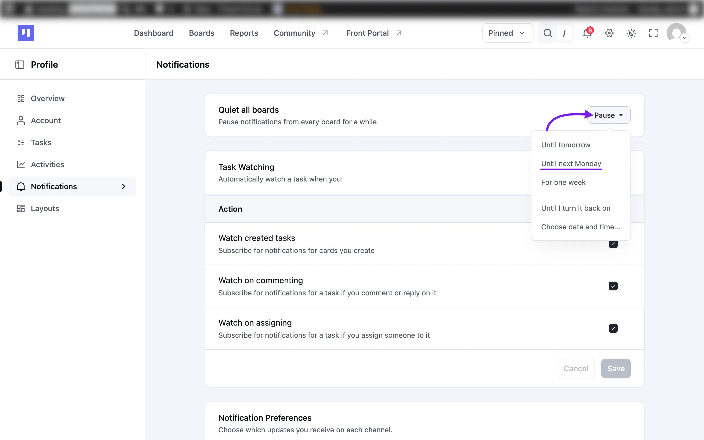
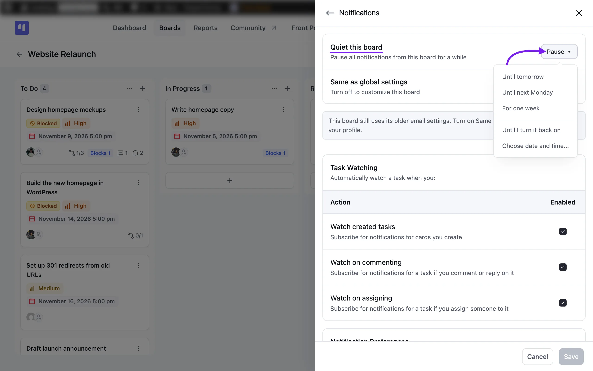

# Notification Settings

FluentBoards Notification Settings give you control over how and when you receive notifications for your board updates. You can customize notifications to match your workflow, choosing alerts for specific actions like task assignments, comments, or due date changes.

This guide will show you how to configure notification settings for individual tasks and entire boards, helping you stay updated.

## Email Notification Settings

To manage your notifications, click on your **Profile Image** in the top right corner of your FluentBoards Dashboard, then select **Account settings**. Next, click **Notifications** in the left sidebar. This page has three sections.

### Quiet All Boards

Click the **Pause** button to silence every board for a while. Learn more in [Pause Notifications](#pause-notifications) below.

### Task Watching

Under **Task Watching**, tick the actions that should add you as a watcher of a task automatically:

- **Watch created tasks**: Subscribe for notifications for cards you create.
- **Watch on commenting**: Subscribe for notifications for a task if you comment or reply on it.
- **Watch on assigning**: Subscribe for notifications for a task if you assign someone to it.

### Notification Preferences

Under **Notification Preferences**, tick the **Email** box next to each event you want to hear about:

- **Comment**: New comments added on a task you are watching.
- **Mentions**: You were mentioned in a task comment. This is its own option, so you can keep mentions on and turn the rest down.
- **Assigned to a task**: You are assigned to a new task.
- **Removed from a task**: You were removed from a task.
- **Stage Changed**: The stage changed on a task you are watching.
- **Dates**: Dates changed on a task you are watching.
- **Priority**: The task priority changed.
- **Description**: The task description changed.
- **Task Archived**: A task you are watching was archived.

Once you're done, click the **Save** button to apply your changes.

> [!Note]
> Several quick updates by the same person to one task now arrive as one grouped notification in the app and one email. Task emails are also written in your WordPress language.

> [!Note]
> FluentBoards notification emails have a fresh design. They switch between light and dark mode automatically to match your email app's appearance setting.

## Board Notification Settings

You have the option to get notifications for specific boards as well. To do this, navigate to the board for which you want to customize notifications, then click on the **Three Dot** button in the top right corner. A **Board Menu** popup will appear, select **Notification Settings** from here.

A **Notification** panel will open for this board. Under **Quiet this board**, click **Pause** to silence just this board for a while.

Toggle **Same as global settings** on if you'd rather this board follow your account-wide preferences. Turn it off to personalize this board. If you see a note that the board still uses its older email settings, turn **Same as global settings** on to follow your profile.

With it off, you will see the same **Task Watching** and **Notification Preferences** options as on your account page. Tick only the events you want for this board.

Once you're done, click the **Save** button to apply your notification changes.

## Pause Notifications

Going on holiday or working toward a deadline? You can pause your email and in-app notifications for a while. A pause only affects you. Board invitations still arrive, so nobody is left waiting on you.

### Pause All Boards

Click on your **Profile Image** in the top right corner of your FluentBoards Dashboard, then select **Account settings**. Next, click **Notifications** in the left sidebar.

Here you will see the **Quiet all boards** section. Click the **Pause** button and choose how long to pause:

- **Until tomorrow**
- **Until next Monday**
- **For one week**
- **Until I turn it back on**
- **Choose date and time...**: Pick your own date and time to resume.

### Pause One Board

Just head over to the board, click the **three Dot** button, and select **Notification Settings**. The **Quiet this board** section sits at the top of the panel. Choose a pause option from the **Pause** button. Your other boards keep notifying you as usual.

Notifications come back on their own at the time you chose. To turn them back on sooner, open the same section and click **Resume notifications**.
