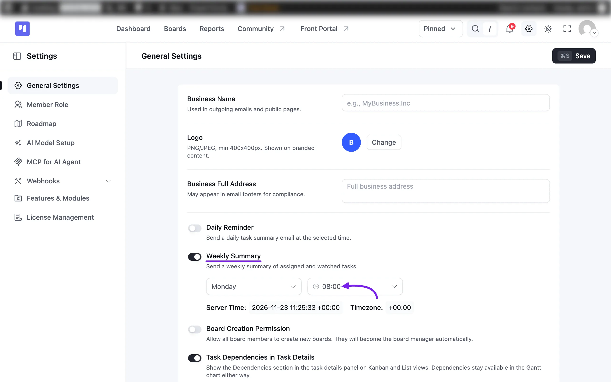

# Weekly Summary

You can keep your team on top of their work with the Weekly Summary email. Each person gets one email with the tasks they are assigned to or watching.

> [!Note]
> **Weekly Summary** is available in FluentBoards Pro.

## What the Email Includes

The email opens with three counts: **Completed**, **Need attention**, and **Upcoming**. Below them, you will find three sections:

- **Recent progress**: Tasks you finished or updated in the past week.
- **Needs attention**: Open tasks that are overdue, high priority, or due today.
- **Upcoming priorities**: Tasks due in the next seven days.

Each section shows up to five tasks with a **View all** link. Every task links back to FluentBoards.

## Who Gets the Email

The summary only includes tasks on boards the recipient can access. It leaves out archived tasks and archived boards.

Two groups of people are skipped:

- Members who paused their notifications. They get the email again once they resume.
- Boards a member paused on their own. Those boards stay out of that member's summary.

## Turn On the Weekly Summary

An admin turns on the Weekly Summary in General Settings. Here is how:

1. Go to FluentBoards **Settings** from the navbar.
2. Click the **General Settings** tab in the left sidebar.
3. Click the **Toggle** button next to **Weekly Summary**.
4. Pick a weekday from the first dropdown and a time from the second one. The default is Monday at 08:00.
5. Once you're done, click the **Save** button in the top right corner.

Use the **Server Time** and **Timezone** shown on the page to make sure the schedule lines up with your day.
