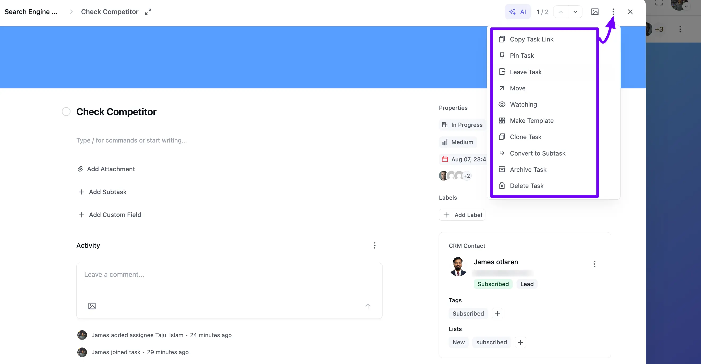
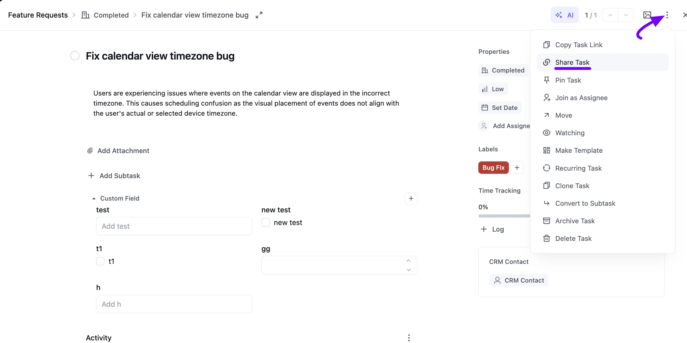
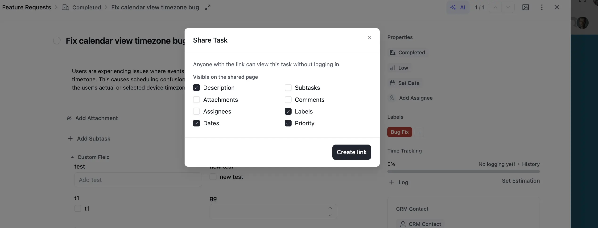

# Task Actions

Open any task, then click the **Three Dot** icon in the top right corner of the task pop-up to reveal the **Task Actions** menu. These actions give you extra options for organizing and managing that task:

- **Copy Task Link**: Copies a link to this task, so you can send it to a teammate who already has access to the board.
- **Share Task**: Creates a read-only link that anyone can open without logging in. See [Share a Task with a Read-Only Link](#share-a-task-with-a-read-only-link) below.
- **Pin Task**: Pin your most critical tasks so they stay at the top of your board, easy to find on busy boards.
- **Join as Assignee / Leave Task**: If you're not assigned to the task yet, this shows as **Join as Assignee**, letting you add yourself with one click. Once you've joined, the same spot shows **Leave Task**, so you can remove yourself as an assignee just as easily.
- **Move**: Allows you to move the task to any board and stage. This experience has been redesigned to make changing a task's stage or board quicker and clearer. Its comments, replies, attachments, and time-tracking entries all move along with it.
- **Watching**: The **Watching** option lets you stay updated on changes and activities for this specific task.
- **Make Template**: This enables you to create a template from the task.
- **Recurring Task**: Sets this task to repeat on a schedule you choose. For the full walkthrough, see the [Recurring Tasks](/recurring-task) guide.
- **Clone Task**: Creates an exact copy of this task, right in the same stage.
- **Convert to Subtask**: Turns this task into a subtask under another task on the board.
- **Archive Task**: Archives the task.
- **Delete Task**: Permanently deletes the task.

## Share a Task with a Read-Only Link

You can easily show a single task to a client or teammate without giving them a login. They open your link and see only that task, and they can't change anything.

### Create a Share Link

Open the task, click the **Three Dot** icon, and select **Share Task**. A pop-up will appear with the sharing options.

Choose what you want visitors to see under **Visible on the shared page**. By default, the link shows the task's labels, due dates, priority, and description. It hides assignees, subtasks, attachments, and comments.

Once you're done, click the **Create link** button. Then click **Copy share link** and send it to anyone you like.

> [!Note]
> If you turn on **Comments**, anyone with the link can read all task comments, including internal discussion. Switch it on only when you're happy for visitors to see everything.

### Change or Turn Off a Share Link

Reopen **Share Task** any time to change what visitors see. Your link stays the same, so you don't need to send it again.

To stop sharing, click the **Disable link** button. The old link stops working right away. If you share the task again later, FluentBoards creates a brand-new link.

A shared link also stops working if the task or its board is archived or deleted.

> [!Note]
> A couple of actions have moved out of this menu. Click the **Image** icon next to the Three Dot icon to change the task's cover, and use the **Add Custom Field** option inside the task body to add a custom field — read the [Custom Fields](/custom-fields-for-task) guide to learn more.
