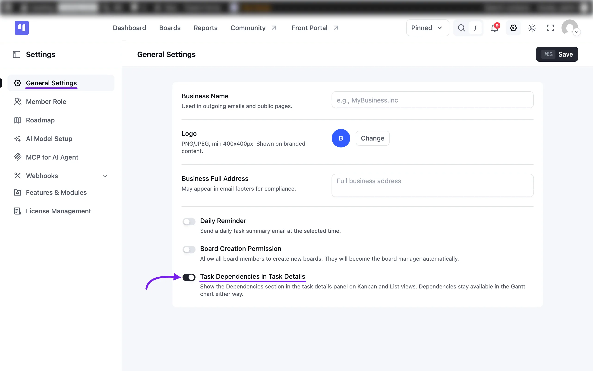
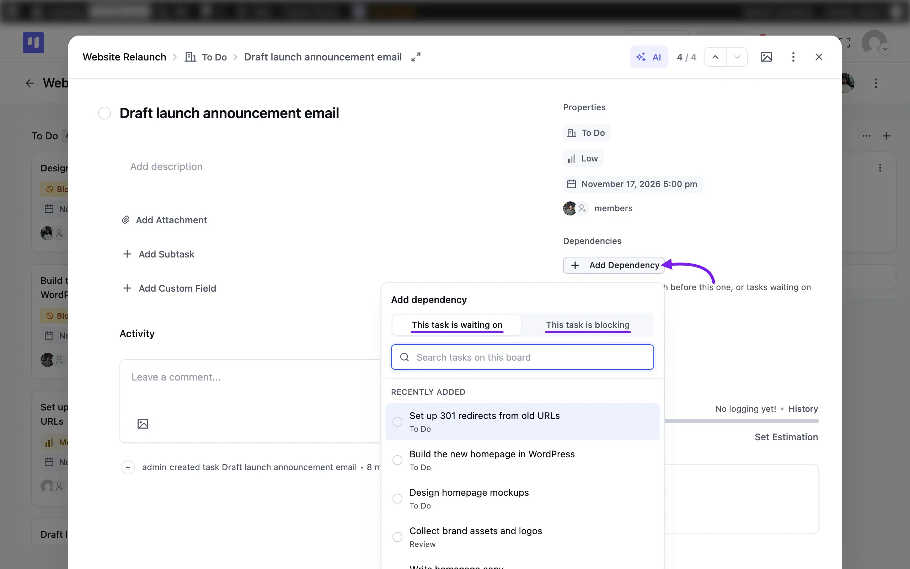
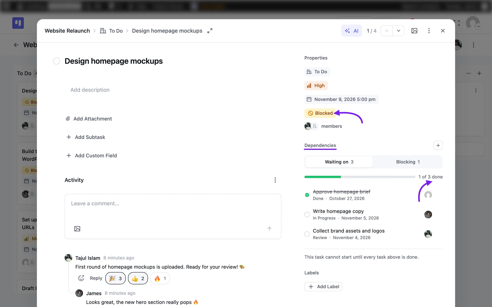
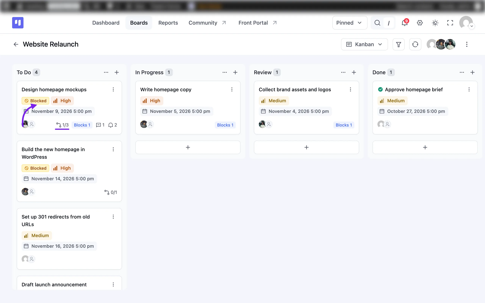

# Task Dependencies

Task Dependencies in FluentBoards let you mark which tasks must finish first. This way, nobody starts work too early or misses a task that's ready to go.

For example, the design can't go to the developer until the brief is approved. Link the two tasks, and FluentBoards flags the design task as **Blocked** until the brief is done.

> [!Note]
> **Task Dependencies** is available in FluentBoards Pro.

## Turn On Dependencies in Task Details

Dependencies always appear in the **Gantt** view. To use them in the task details of your Kanban and List views, an admin needs to turn them on first.

Go to FluentBoards **Settings** from the navbar, then click on the **General Settings** tab in the left sidebar.

Turn on the **Task Dependencies in Task Details** toggle. Once you're done, click the **Save** button in the top right corner.

## Add a Dependency

Open any task. Here you will see a **Dependencies** section in the task details panel.

Click on the **Add Dependency** button. A pop-up will appear with two tabs:

- **This task is waiting on**: Pick the tasks that must finish before this one can start.
- **This task is blocking**: Pick the tasks that can't start until this one is done.

Choose a tab, then select the tasks you want to link. The **Recently Added** list shows your newest tasks before you type. To find any other task, enter its name in the **Search tasks on this board** field.

## Track Your Dependencies

Once you've linked tasks, the **Dependencies** section shows them in two tabs:

- **Waiting on**: The tasks this one is waiting for. The number shows how many there are.
- **Blocking**: The tasks waiting for this one to finish.

A progress bar shows how much of the linked work is already done, such as **1 of 3 done**. Each linked task also shows its stage, due date, and assignee. Finished tasks are crossed out.

The task stays **Blocked** until every task it's waiting on is done. You'll see the **Blocked** label under **Properties**. To link more tasks, simply click the **Plus** icon next to **Dependencies**.

### On Your Task Cards

You can spot dependencies right from your board, too. A blocked task card shows a **Blocked** label. The card also shows how many of its dependencies are done, such as **1/3**. A **Blocks** tag tells you how many tasks are waiting on it.

